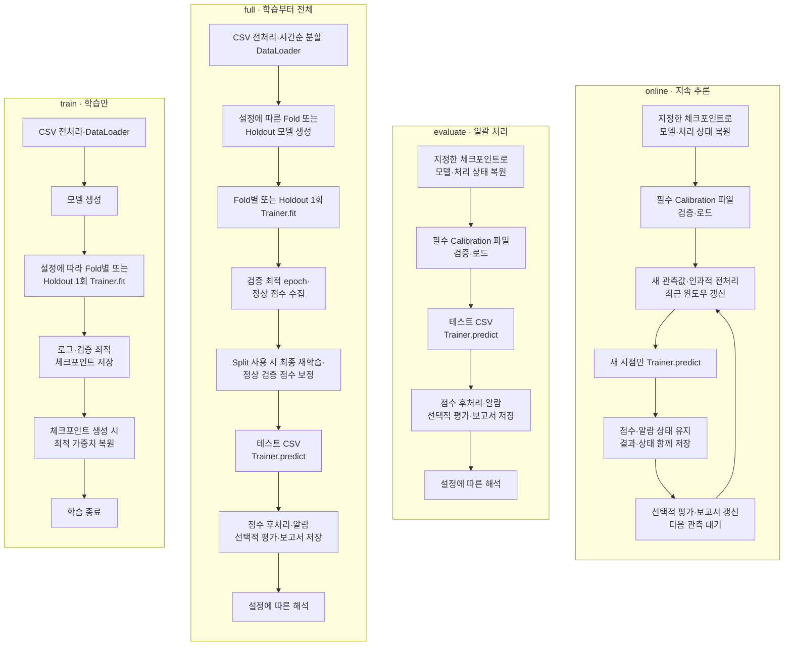

# GSC_EWS 통합 파이프라인 가이드

기준: 2026-09-28, `dsenv.onepredict.net`의 `/workspace/GSC_EWS` 작업 코드.
이 문서는 리팩토링된 코드의 실행·설정·확장·산출물 해석을 한곳에서 설명한다.
경로를 짧게 표기한 경우 프로젝트 루트 `/workspace/GSC_EWS`를 기준으로 한다.

## 목차

1. [구조와 처리 흐름](#1-구조와-처리-흐름)
2. [설치와 빠른 실행](#2-설치와-빠른-실행)
3. [실행 모드](#3-실행-모드)
4. [설정 파일](#4-설정-파일)
5. [입력 데이터와 전처리](#5-입력-데이터와-전처리)
6. [모델·학습·Lightning](#6-모델학습lightning)
7. [점수·보정·알람·평가](#7-점수보정알람평가)
8. [산출물과 열 정의](#8-산출물과-열-정의)
9. [기존 산출물과의 대응](#9-기존-산출물과의-대응)
10. [Attention·TFT·SHAP 해석](#10-attentiontftshap-해석)
11. [온라인 추론과 재시작](#11-온라인-추론과-재시작)
12. [모델 추가와 유지보수](#12-모델-추가와-유지보수)
13. [검증과 문제 해결](#13-검증과-문제-해결)

## 1. 구조와 처리 흐름

TFT와 TranAD가 전처리·DataLoader·학습 실행·추론·평가·저장을 공유한다.
모델별 네트워크, 손실 함수, 이상 점수는 `models/<모델명>.py`에 모았다.
등록된 두 모델을 바꿔 실험할 때는 YAML 또는 `--model`만 변경한다.

```text
main.py                         모드와 CLI 옵션 처리
configs/
  config.yaml                   실행·데이터·모델·학습·후처리·출력·분석
  alarm.yaml                    알람 규칙
  threshold.yaml                임계값 규칙
models/
  base.py                       공통 LightningModule, 배치 처리·최적화·체크포인트
  tranad.py                     TranAD 네트워크·손실·점수·어댑터
  tft.py                        TFT 네트워크·손실·점수·어댑터
src/
  workflow.py                   모드별 단계 연결
  preprocessing.py              전처리 함수와 실행 순서 적용
  dataloader.py                 CSV·스케일러·Dataset·DataLoader
  model.py                      명시적 모델 레지스트리·생성·복원
  trainer.py                    학습/추론 Trainer·최적 가중치 복원·학습 이력
  inference.py                  Trainer.predict·행 정렬·원본 단위 복원
  scoring.py                    학습 점수 보정·보정값 검증·후처리 적용
  alarm.py                      연속 감지·알람 레벨·쿨다운·억제
  evaluation.py                 복원 품질과 탐지·순위 지표
  explainer.py                  Attention·TFT 변수 중요도·SHAP
  save.py                       CSV·JSON·TXT·Excel·플롯 저장 연결
  online_runner.py              시간순으로 늘어나는 CSV 감시
  udf/
    configuration.py            YAML 로딩·검증·경로 해석
    metrics.py                  탐지·순위 지표와 별도 Point-Adjust 함수
    quality.py                  복원 품질 계산
    postprocessing.py           점수 이동 평균·학습 통계 기반 정규화
    threshold.py                임계값 계산 알고리즘
    visualization.py            공통 플롯 함수
tests/                          데이터·모델·모드·저장·플롯 검증
docs/                           설명 문서
```

`src/`의 상위 파일은 파이프라인의 기능 단계다. `src/udf/`는 각 단계에서 재사용하는
보조 계산·검증·시각화다. 상위 모듈마다 같은 이름의 UDF 파일을 만들지 않는다.
`workflow.py`는 선택한 모드에 따라 아래 네 경로 중 하나를 실행한다.
모드를 가로로 나란히 표시했으며, 각 모드 안에서는 위에서 아래로 읽는다.



### 모드별 설명

- **`train` — 학습만:** 학습·검증을 실행하고 학습 로그와 체크포인트를 저장한다. 테스트 평가·알람·해석은 실행하지 않는다.
- **`full` — 학습부터 전체 실행:** 학습 후 최적 체크포인트를 복원하고, 학습 구간으로 임계값을 보정한 뒤 테스트 추론·알람·선택적 평가·결과 저장을 수행한다. 설정에 따라 해석도 실행한다.
- **`evaluate` — 일괄 처리:** 재학습 없이 지정한 CSV 전체를 추론한다. 체크포인트와 보정값이 모두 필요하며, 평가 옵션과 정답 라벨이 있으면 탐지 성능도 계산한다. 설정에 따라 해석을 실행한다.
- **`online` — 지속 추론:** 모델·보정값을 한 번 로드하고 새 관측값만 추론한다. 윈도우·점수·알람 상태를 유지하고 결과와 함께 저장하며 중단할 때까지 반복한다. 해석은 실행하지 않는다.


신규 학습은 모델 생성부터 시작하며, 학습 후 이번 실행의 최적 가중치를 복원한다.
독립 평가·추론은 지정한 체크포인트에서 시작하며 재학습하지 않는다.
`run_prediction()`이 추론 → 후처리 → 알람 → 선택적 평가를 연결하며 배치와 CSV 감시가 이를 공유한다.
저장 함수는 이미 계산된 결과를 받아 기록한다.

## 2. 설치와 빠른 실행

### 환경 준비

Python 3.10 이상을 기준으로 한다. 사용할 Python 환경에서 다음을 실행한다.
CUDA용 PyTorch 환경은 서버에 맞게 준비되어 있어야 한다.

```bash
cd /workspace/GSC_EWS
python -m pip install -r requirements.txt

# SHAP을 사용할 때만 추가 설치한다.
python -m pip install -r requirements-analysis.txt
```

주요 의존성은 PyTorch, Lightning, NumPy, pandas, PyYAML, SciPy, scikit-learn,
matplotlib, openpyxl이다. 정확한 허용 버전은 두 requirements 파일을 따른다.

이 서버에서 앞서 검증에 사용한 실행 환경은 다음과 같다.
현재 셸의 `python`이 이미 올바른 환경을 가리키면 일반 명령을 사용하면 된다.

```bash
PYTHONPATH=/workspace/.venv/lib/python3.12/site-packages \
  /usr/bin/python3.12 main.py --mode train --model tranad --fast-dev-run
```

### 첫 실행 순서

1. `configs/config.yaml`의 학습·테스트 경로, 시각 컬럼, 특성 컬럼을 확인한다.
2. `active_model`과 `models.<모델명>`을 확인한다.
3. 설정 출력과 한 배치 학습으로 입력·모델 연결을 확인한다.
4. 새 출력 폴더를 지정하여 전체 실험을 실행한다.

```bash
cd /workspace/GSC_EWS
python main.py --model tranad --mode full --print-config
python main.py --model tranad --mode train --fast-dev-run
python main.py --model tranad --mode full --output results/tranad_run01
python main.py --model tft --mode full --output results/tft_run01
```

`--print-config`는 실행 설정을 출력하고 종료한다. 별도 알람·임계값 파일의 최종 병합 결과나
체크포인트에서 복원한 설정까지 모두 펼쳐 보여주는 기능은 아니다.
`--output`은 보고서 저장 위치를 바꾸며 체크포인트·학습 로그 위치는 바꾸지 않는다.
종료 시 출력하는 `checkpoint`, `calibration`, `output_directory`를 이후 실행에 사용한다.

## 3. 실행 모드

모드는 실행의 시작점과 종료 조건을 정한다. 저장 모델 해석은 독립 `analyze` 모드로도 실행할 수 있다.

| 모드 | 시작점 | 실행 범위·종료 조건 |
| --- | --- | --- |
| `full` | 학습 CSV·모델 설정 | 학습·최적 모델 복원·보정·일괄 추론·결과 저장 후 종료 |
| `train` | 학습 CSV·모델 설정 | 학습·검증·체크포인트·학습 로그 저장 후 종료 |
| `evaluate` | 체크포인트·입력 CSV | 전체 입력의 일괄 추론·결과 저장 후 종료 |
| `online` | 체크포인트·보정값·시간순 입력 CSV | 새 관측값만 처리하며 사용자가 중단할 때까지 반복 |
| `analyze` | 체크포인트·분석 CSV | Attention·변수 중요도·선택적 SHAP 저장 후 종료 |

`full`은 학습과 일괄 처리를 연결하며 온라인 운영을 자동 시작하지 않는다.
`train`은 테스트·라벨 CSV를 읽지 않는다. `evaluate`는 일괄 추론만 수행하는 용도로도 사용한다.
과거 `all`, `predict` 모드와 `--watch`·`--no-watch`, `run.watch`는 제거했다. 별칭은 제공하지 않는다.

### 선택적 평가와 해석

- `evaluation.enabled: true`: 복원 품질을 계산하고 라벨이 있으면 탐지·순위 지표도 계산한다.
- `evaluation.enabled: false`: 정답 라벨을 읽지 않고 지표·품질 보고서를 생략한다. 추론·점수·알람·시점별 결과는 저장한다.
- `analysis.enabled`: `full`·`evaluate`의 Attention·TFT·SHAP 해석을 제어한다. 평가와 독립적이다.
- `analyze` 모드를 명시하면 `analysis.enabled`와 관계없이 분석을 실행한다.
- `output.plots`, `output.excel`: 공통 그림·Excel 저장 여부다. 평가를 껐으면 품질·성능 관련 그림·시트는 만들지 않는다.

평가를 껐을 때의 보고서 부재와 라벨이 없을 때의 `N/A`는 다르다.
`N/A`는 평가를 실행했지만 해당 지표의 정답이 없는 경우다.

### 학습

```bash
python main.py --mode full --model tranad_v2 --output results/tranad_run01
python main.py --mode train --model tft
python main.py --mode train --model tranad_v2 --fast-dev-run
```

`--fast-dev-run`은 `train` 전용이며 체크포인트를 저장하지 않는다.

### 저장 모델 일괄 처리

아래 `실제_최적모델.ckpt`는 학습 종료 시 출력된 실제 경로로 바꾼다.

```bash
# 저장 보정값을 재사용하며 학습 CSV는 읽지 않는다.
python main.py --mode evaluate \
  --checkpoint checkpoints/tranad/실제_최적모델.ckpt \
  --calibration results/tranad_run01/calibration.yaml \
  --input data/new_data.csv --output results/tranad_batch01
```

`evaluate` 입력은 `--input`/`run.input_path`가 있으면 해당 CSV, 없으면 `data.test_path`다.
추론만 하려면 위 재사용 경로와 다음 설정을 함께 사용한다.

```yaml
evaluation:
  enabled: false
analysis:
  enabled: false
```

평가·해석이 필요하면 각 `enabled`를 켠다. 라벨은 `data.labels_path`에서 지정한다.
`evaluate`는 체크포인트와 Calibration 파일이 모두 없으면 즉시 중단한다.
저장 보정값으로 평가할 때는 학습 배경이 없으므로 SHAP을 사용할 수 없다.

### 저장 모델 해석

```bash
python main.py --mode analyze \
  --checkpoint checkpoints/tranad/실제_최적모델.ckpt \
  --input data/analysis_target.csv \
  --output results/tranad_analysis01
```

학습·Calibration·Evaluation·알람 판정 없이 체크포인트의 모델·스케일러·피처 순서를 재사용한다.
SHAP을 켰다면 정상 기준 CSV를 `--background`로 추가한다.

```bash
python main.py --mode analyze \
  --checkpoint checkpoints/tranad/실제_최적모델.ckpt \
  --input data/analysis_target.csv \
  --background data/normal_train.csv \
  --output results/tranad_shap01
```

### 온라인 추론

```bash
python main.py --mode online \
  --checkpoint checkpoints/tranad/실제_최적모델.ckpt \
  --calibration results/tranad_run01/calibration.yaml \
  --input data/online.csv --output results/tranad_online01
```

`evaluate`·`online`·`analyze`의 모델 종류·구조·dtype·이상 점수는 체크포인트에서 결정한다.
세 모드에는 `--model`, `--max-epochs`를 지정하지 않는다.
온라인 처리와 재시작 규칙은 11절을 참고한다.

### CLI 옵션

| 옵션 | 역할 |
| --- | --- |
| `--config` | 통합 YAML, 기본 `configs/config.yaml` |
| `--mode` | `full`, `train`, `evaluate`, `online`, `analyze` |
| `--model` | full/train의 모델 선택 |
| `--checkpoint` | evaluate/online/analyze에서 복원할 체크포인트 |
| `--calibration` | 체크포인트와 짝을 이루는 보정 YAML, evaluate/online 필수 |
| `--input` | full/evaluate/analyze의 입력 덮어쓰기 또는 online 입력 |
| `--background` | SHAP 정상 배경 CSV, analyze에서 `analysis.shap: true`일 때 필수 |
| `--output` | 결과 출력 폴더 |
| `--alarm-config`, `--threshold-config` | 알람·임계값 규칙 YAML |
| `--device` | auto/cpu/gpu/cuda/mps, 실제 장치 지원 필요 |
| `--max-epochs` | 학습 총 epoch 상한 |
| `--fast-dev-run`, `--no-fast-dev-run` | train의 한 배치 점검 여부 |
| `--print-config` | 실행 설정을 출력하고 종료 |

## 4. 설정 파일

사용자가 관리하는 설정은 세 개다. 실행 결과인 `calibration.yaml`은 자동 생성된 보정 상태이며
네 번째 수동 설정 파일이 아니다.

| 파일 | 책임 |
| --- | --- |
| `configs/config.yaml` | 실행·경로·데이터·전처리·DataLoader·모델·학습·후처리·평가·출력·분석·온라인 |
| `configs/alarm.yaml` | 알람 레벨·연속 횟수·최소 변수 수·쿨다운·억제 조건 |
| `configs/threshold.yaml` | 임계값 방식·공통값·변수별 값·POT 등 보정 매개변수 |

`run.alarm_config_path`, `run.threshold_config_path`로 연결한다. `train`에서는 두 규칙 파일을 읽지 않는다.
기존 Python config, `ews_config`, `train_config`를 별도로 관리하지 않는다.

### 적용 규칙

- YAML 안의 상대 경로는 해당 YAML 위치 기준이다. `configs/config.yaml`의 `../data`는 프로젝트의 `data/`다.
- CLI 경로는 명령을 실행한 현재 폴더 기준이다. CLI에서 명시한 값이 대응하는 YAML 값을 덮어쓴다.
- 알람과 임계값 설정은 모델을 구분하지 않고 모든 모델에 공통으로 적용한다.
- 후처리·평가·출력·분석·온라인 설정도 모델별 덮어쓰기 없이 모든 모델에 공통으로 적용한다.
- 임계값 방식은 `threshold.yaml`의 `method`로 명시한다.
- Calibration 파일을 재사용하는 일괄 추론과 온라인의 전처리·스케일러·특성·DataLoader 규칙은 체크포인트, 점수 후처리·임계값은 Calibration 파일을 따른다.
- Calibration 파일을 재사용하는 실행에서는 YAML의 후처리·임계값만 바꿔도 보정 결과가 바뀌지 않는다. 다시 보정해야 한다.

### 현재 설정의 주요 값

이 표는 문서 작성 시점의 기본값이다. 실행 때는 실제 YAML을 확인한다.

| 항목 | 현재 값 |
| --- | --- |
| 기본 모델·모드 | `tranad_v2`, `full` |
| 시각 컬럼·수집 간격 | `DateTime`, 60초 |
| 단절 기준 | 예상 간격 × 1.5보다 큰 간격 |
| 검증 구간 | 기본 TimeSeriesSplit 5개, 비활성화 시 뒤쪽 20% |
| 데이터 정규화 | Min-Max, `clip: false` |
| 기본 결측 처리 | 학습은 `drop`, 추론은 계기 이상 알람 후 제외 |
| 평가 | `evaluation.enabled: true` |
| 학습/평가 배치 | 128 / 4096 |
| 윈도우 시작 패딩 | `pad_start: true` |
| 최적화·스케줄러 | AdamW, StepLR: 5 epoch마다 ×0.9 |
| 조기 종료 | `val_loss`, patience 3, min_delta 0.00001 |
| 모델별 최대 epoch | 모든 모델 30 |
| TranAD | 윈도우 15, float64, 점수 `mae`, gradient clip 0 |
| TFT | 윈도우 24, float32, 점수 `quantile_loss`, gradient clip 1 |
| 공통 후처리 | 이동 평균 1, `normalization_method: quantile` |
| 공통 임계값 | **percentile 99.5** |
| 알람 | 3회 연속, 최소 1개 변수, 쿨다운 60초 |
| 출력·해석 | Excel·공통 플롯·해석·Attention 켬, SHAP 끔 |

`threshold.yaml`의 `method`는 선택한 모델에 공통 적용되며 모델에 따라 자동 변경되지 않는다.

## 5. 입력 데이터와 전처리

### CSV 규격

파일 입력은 현재 CSV를 지원한다. 내부 추론 함수는 pandas DataFrame도 받는다.
Parquet·Excel 전용 파일 로더는 없다.

```csv
DateTime,sensor_a,sensor_b
2026-09-01 00:00:00,1.2,3.4
2026-09-01 00:01:00,1.3,3.5
```

`data.feature_columns: null`이면 시각 컬럼을 제외한 모든 컬럼을 특성으로 선택한다.
문자열 메타데이터가 있으면 특성명을 명시한다. 학습·테스트의 특성 이름과 순서는 일치해야 한다.

현재 학습용 CSV 로더는 특성 목록을 명시하면 `usecols`로 시각·특성만 읽는다.
따라서 그 밖의 부가 컬럼은 `full` 결과에 남지 않는다.
전체 CSV를 읽는 `build_prediction_data()` 경로에서는 남아 있는 부가 컬럼을 출력에 보존한다.

### 처리 순서

1. 시각 파싱·정렬·중복 처리 후 학습 라벨이 있으면 이상 행을 제외한다.
2. `time_series_split_enabled=true`면 정상 데이터를 확장형 시간순 Fold로 나누고, `false`면 앞쪽 Train과 뒤쪽 Validation으로 한 번만 나눈다.
3. 각 분할에서 독립적으로 수치 변환·선택적 운전 조건 기반 정지 행 제거·학습용 결측 전략을 수행한다. Test 결측은 계기 이상으로 분리한다.
4. 각 Train 구간에만 스케일러를 맞추고 해당 Validation 구간에 재사용한다.
5. TimeSeriesSplit은 Fold별 최적 Epoch의 중앙값만큼 전체 정상 데이터를 재학습한다. 단일 Holdout은 전체 재학습 없이 최저 Validation loss Checkpoint를 운영 모델로 사용한다.
6. 시간 단절을 구분하여 각 분할 안에서 윈도우를 만든다.
7. Dataset이 요청 시 윈도우를 잘라 표준 배치를 반환한다.

현재 전처리 순서는 `prepare_time_index → coerce_numeric → drop_stopped → missing.strategy`다.
일반 단계는 `preprocessing.steps`, 학습용 결측 처리는 `preprocessing.missing`에서 변경한다.
스케일러는 `minmax`, `standard`, `robust`, `none`을 지원한다.

#### 공정 정지 제거(`drop_stopped`)

`drop_stopped`는 임의 피처의 값이 0이라는 이유만으로 공정 정지로 판단하지 않는다.
모터 파워·런타임처럼 사전에 정한 운전 tag와 원본 공정 단위 임계값을 명시해야 한다.

- `enabled: false`: 정지 판정을 수행하지 않는다. 실제 운전 tag와 임계값을 확정하기 전 기본값이다.
- `enabled: true`: `conditions`의 각 `variable`, `operator`, `value`를 원본값에 적용한다.
- `variable`: `data.feature_columns`에 포함된 정확한 tag 이름이어야 한다.
- `operator`: `<`, `<=`, `>`, `>=`만 지원한다.
- `value`: 정규화값이 아닌 원본 공정 단위의 임계값이다.
- `logic: any`: 조건 중 하나라도 맞으면 정지로 판단하는 OR 방식이다.
- `logic: all`: 모든 조건이 맞아야 정지로 판단하는 AND 방식이다.
- 기능을 켰는데 조건이 비어 있거나 tag·연산자가 잘못되면 실행 전에 오류로 중단한다.

학습과 Validation에서는 정지 행을 모델 입력에서 제외한다. `full`의 Test와 `evaluate`에서도
정지 행을 추론하지 않는다. `online`에서는 해당 입력 시각을 처리 완료로 기록하지만
`predictions.csv`에는 예측 행을 만들지 않고 Window를 초기화한다. 따라서 정지 전 데이터와
재가동 후 데이터가 하나의 Window로 연결되지 않는다.

`drop_stopped`는 데이터·추론 대상 자체를 제거하는 기능이고, `alarm.yaml`의 Inhibit은 점수 계산은
유지하면서 알람만 억제하는 기능이다. Online에서 0·NA 계기 이상 알람까지 정지로 억제하려면
같은 운전 조건을 `alarm.yaml.inhibit_conditions`에도 설정해야 한다.

윈도우는 현재 시점을 포함하고 마지막 관측값을 복원한다. TFT도 현재 파이프라인에서는
미래 여러 시점을 예측하는 용도가 아니며 `forecast_horizon: 1`을 사용한다.
`pad_start: true`는 구간 첫 값을 반복하여 부족한 길이를 채운다.
`false`이면 각 구간의 충분한 과거가 없는 행은 출력에서 빠진다.
`index`는 전처리 후 해당 분할의 행 번호이며 원본 CSV 파일의 물리적 줄 번호가 아니다.

#### 결측 처리 전략

`preprocessing.missing.strategy`는 Train/Validation에만 적용한다.

- `drop`: 결측 피처가 하나라도 있는 행을 제외한다. 기본값이며 Online 배포가 가능하다.
- `forward_fill`: 같은 연속 구간의 피처별 최근 정상값으로 `max_consecutive`개까지 채우고 나머지 행은 제외한다.
- `interpolate`: 같은 연속 구간의 앞뒤 정상값으로 `max_consecutive`개까지 보간하고 나머지 행은 제외한다.

Full의 Test, Evaluate, Online에서는 전략과 관계없이 원본 NA·비수치 값을 `INSTRUMENT_FAULT`로
기록하고 해당 시점을 추론하지 않는다. `predictions.csv`에는 시각과 원본값만 남기고
모델 예측·점수는 빈 값으로 저장한다. Online은 0도 계기 이상으로 판단한다.

Online은 학습과 운영의 인과적 전처리를 일치시키기 위해 `drop`으로 학습한 체크포인트만 허용한다.
`forward_fill`이나 미래값을 참조할 수 있는 `interpolate` 체크포인트를 Online에 사용하려면
`drop`으로 다시 학습·Calibration해야 한다.

### 정답 라벨

- `data.labels_path`에 라벨 CSV를 지정한다. 없으면 `null`로 둔다.
- 시각 컬럼이 있으면 테스트 시각에 맞춰 결합한다. 라벨 시각은 유효하고 중복이 없어야 한다.
- 시각 컬럼이 없으면 전처리 후 테스트 행 수와 같아야 한다.
- 변수별 라벨은 특성명 또는 `label_columns` 순서로 맞춘다. 값이 0보다 크면 이상이다.
- 라벨 컬럼 하나는 모든 특성에 복제한다. 변수별 원인 정답과는 의미가 다르므로 순위 지표 해석에 주의한다.
- 라벨이 없을 때 내부 배치의 0 배열은 형태를 맞추기 위한 값이다. `labels_provided: false`로 평가에서 제외하고 `predictions.csv`에는 `N/A`로 저장한다.

## 6. 모델·학습·Lightning

### 모델 선택

`src/model.py`의 `MODEL_REGISTRY`가 `tranad → TranADLightningModule`,
`tft → TFTLightningModule` 연결을 관리한다. 학습 생성과 체크포인트 복원이 같은 등록 정보를 사용한다.
이름의 앞뒤 공백·대소문자는 정리하고, 미등록 이름은 오류로 처리한다.
`models/__init__.py`에 별도 선택 목록을 유지하지 않는다.

### Lightning이 담당하는 부분

| 담당 | 현재 구현 |
| --- | --- |
| 학습·검증 반복, 역전파·최적화 | `Trainer.fit()`, `training_step()`, `validation_step()` |
| 보정·테스트·새 CSV의 배치 추론 | `Trainer.predict()`와 모델의 `predict_step()` |
| 장치·정밀도 | Trainer 단일 장치, float32는 `32-true`, float64는 `64-true` |
| 학습 로그 | `CSVLogger` |
| 최적/마지막 가중치 저장 | `ModelCheckpoint` |
| 조기 종료·gradient clipping | Trainer와 콜백 |
| EWS 점수 후처리·알람·최종 보고서 | 공통 `src/` 파이프라인 |

호출부가 `predict_step()`을 직접 실행하지 않는다. `evaluate`라는 모드 이름도
`Trainer.test()`를 뜻하지 않는다. 현재는 `Trainer.predict()` 결과를 공통 평가 함수에 전달한다.
해석은 별도 모델 실행을 사용하고, SHAP의 미분이 필요한 경로를 추론 루프 밖에 둔다.

`gradient_clip_val`은 큰 기울기를 제한하는 학습 옵션이다. 0이면 제한하지 않는다.
TimeSeriesSplit은 Fold별로 가장 낮은 `val_loss`의 Epoch를 선택하고, 그 중앙값을 전체 정상 데이터 재학습 횟수로 사용한다.
이때 운영 모델은 최종 재학습 Checkpoint이며, 보정은 Fold별 OOF 점수 전체를 사용한다.
TimeSeriesSplit을 끄면 단일 Holdout의 최저 `val_loss` Checkpoint가 운영 모델이고 해당 Validation 점수로 보정한다.

### 모델별 손실과 점수

| 모델 | 학습 손실 | 선택 가능한 이상 점수 |
| --- | --- | --- |
| TranAD | epoch에 따라 가중한 Phase 1/2 MSE | `mae`, `phase2_mse`, `hybrid` |
| TFT | `mse_quantile` 또는 `quantile` | `quantile_loss`, `median_mse`, `band_mse`, `band_violation` |

학습 손실과 운전용 점수는 같은 개념이 아니다. 예를 들어 TranAD는 MSE로 학습하면서 MAE를
이상 점수로 사용할 수 있다. 점수 선택은 `models.<모델명>.anomaly_score` 하나로 관리한다.
TranAD 보고서의 복원값은 Phase 2 출력이다. TFT는 기본적으로 중앙 분위수 출력이며,
`band_mse`를 선택하면 모델의 band 출력을 저장한다.

### 로그와 체크포인트

- 학습 로그: `logs/<설비>/<모델>/<버전>/<실행ID>/<학습구간>/metrics.csv`, `hparams.yaml`.
- 로그 항목: `train_loss`, `val_loss`, `train_anomaly_score`, `val_anomaly_score`, `learning_rate` 등.
- 체크포인트: `checkpoints/<설비>/<모델>/<버전>/<실행ID>/<학습구간>/epoch=...-val_loss=....ckpt`,
  `last.ckpt`.
- `<학습구간>`은 TimeSeriesSplit에서 `fold_01`·`final`, 비활성화 시 `holdout`이다.
- 같은 모델·버전으로 다른 설비나 데이터셋을 실행해도 설비와 실행 ID가 다르면 결과가 섞이지 않는다.
- 같은 이름이 존재하면 Lightning이 버전 접미어를 붙일 수 있으므로 실제 출력 경로를 사용한다.
- 체크포인트에는 모델 설정·가중치와 `data_state`의 스케일러·특성 순서·처리 규칙이 포함된다.
- `include_scaler`, `include_feature_schema`는 전체 실행과 독립 추론을 위해 켜 둔다.
- 과거 분리형 모델의 체크포인트가 현재 통합 체크포인트 형식과 바로 호환된다고 가정하지 않는다.

## 7. 점수·보정·알람·평가

### Calibration 파일

`calibration.yaml`은 TimeSeriesSplit의 모든 OOF Validation 점수 또는 단일 Holdout의 Validation
점수로 계산한다. 주요 내용은 체크포인트 SHA-256,
특성 순서, 점수 이름, 후처리 설정과 통계, 변수별 임계값, 보정 행 수다.
변수별 임계값은 `thresholds.<피처명>: <값>` 매핑으로 저장한다. `manual` 방식에서
`per_variable`에 없는 피처에는 `threshold.yaml`의 `default` 값이 적용되며 적용 설정은
`threshold_settings`에도 함께 기록된다.
체크포인트와 Calibration 파일은 한 쌍이다. 다른 가중치의 파일을 섞으면 거부한다.
Calibration 파일은 수동 편집하지 않고 해당 체크포인트로 다시 생성한다.

### 점수 단계

1. 모델이 정규화된 입력 기준 `raw_score`를 만든다.
2. 현재·과거만 사용하는 이동 평균을 적용한다. 시간 단절에서는 이력을 비운다.
3. 공통 `normalization_method`에 따라 정규화하지 않거나, Validation 점수의 분위수 또는 median/MAD로 정규화한다.
4. `quantile` 방식은 피처별 정규화 점수와 샘플 전체 평균 raw score를 `mae_weight` 비율로 결합한다.
5. 최종 `score`를 같은 단위의 변수별 `threshold`와 비교한다.
`normalization_method`는 `none`, `robust`, `quantile` 중 하나만 선택하므로 서로 충돌하는 설정이 없다.
모델별 덮어쓰기 없이 선택한 방식을 모든 모델에 공통 적용한다.

임계값 방식은 수동(`manual`), 백분위수(`percentile`), 평균·표준편차 기반(`sigma`),
꼬리 분포 기반(`pot`)이다. `per_variable`로 특성명 또는 0부터 시작하는 인덱스별 값을 지정한다.
`score_overall`은 최종 변수별 점수의 평균이다. 전체 알람은 이 평균 하나를 임계값과 비교해서 만들지 않는다.

### 알람 상태와 이벤트

- `score > threshold`가 `consecutive_count`번 이어지면 해당 변수 알람이 켜진다.
- 활성 변수 수가 `min_variables` 이상이면 전체 알람이 켜진다.
- `score / threshold` 비율로 CAUTION·WARNING 두 레벨을 정한다.
- 쿨다운은 같은 변수·레벨 이벤트의 반복 기록을 제한한다. 시점별 알람 상태 자체를 끄지 않는다.
- 억제 조건은 `alarm.yaml`의 운전 tag별 `variable`, `operator`, 원본 단위 `value`로 검사하고
  `inhibit_logic: any`(OR) 또는 `all`(AND)로 결합한다. 억제 시점과 단절에서 연속 횟수를 초기화한다.
- Online에서는 억제 조건이 아닌 운전 중 원본 `0`·`NA`·비수치 입력을 계기 이상으로 기록하고 해당 행을 추론에서 제외한다.
- CRV는 정규화 전 원본 공정값을 `alarm.yaml`의 태그별 `low/high`와 비교한다. Calibration의
  Anomaly Score Threshold와 별개이므로 모델 재학습이나 Calibration 재생성 없이 변경할 수 있다.
- CRV도 연속 횟수, 쿨다운과 Inhibit을 적용하며 `CRV_LOW` 또는 `CRV_HIGH` 이벤트로 저장한다.
- `alarms.csv`에는 변수별 이벤트와 조건을 만족한 `OVERALL` 이벤트가 들어간다. 한 시점에 여러 행이 가능하다.
  `event_type`은 모델 점수 알람 `MODEL_ANOMALY`, 공정값 범위 알람 `CRV_LOW`·`CRV_HIGH`, 계기 이상
  `INSTRUMENT_FAULT`를 구분한다.
- `predictions.csv`에는 모델 알람과 별도로 `crv_alarm_overall`, `<태그>__crv_alarm`,
  `<태그>__crv_direction`을 저장한다.

따라서 `predictions.csv`의 알람 행 수와 `alarms.csv`의 이벤트 행 수는 같지 않을 수 있다.

### 평가 지표

평가를 켰을 때 복원 품질(MAE·RMSE·R²·MAPE)은 실측값과 복원값으로 계산하며 정답 이상 라벨이 필요 없다.
실측·복원·MAE·RMSE는 원본 공정 단위, MSE는 그 제곱 단위다.
이상 점수는 모델과 보정 설정의 단위이므로 CSV의 MAE와 점수 숫자가 같을 필요가 없다.

`evaluation.enabled: true`이고 정답 라벨이 있을 때 Precision·Recall·F1·TP·TN·FP·FN·ROC-AUC·Hit·NDCG를 계산한다.
현재 탐지 지표는 **변수별 `score > threshold` 판정**을 기준으로 한다. 전체 지표는 시점×변수
원소를 합산한 결과이며, 연속 감지·억제·쿨다운 이후의 운전 알람 성능을 직접 계산한 것은 아니다.
ROC-AUC에는 연속 점수를 사용한다. Point-Adjust 함수는 별도 평가용으로만 두고 기본 실행에는 적용하지 않는다.

**라벨이 없으면:** TXT·플롯의 탐지 지표는 `N/A`, JSON의 `labels_provided`는 `false`다.
JSON에서 탐지·순위 항목을 생략하고, `metrics.csv`에도 그 열을 만들지 않는다.
라벨이 있어도 한 종류뿐이면 ROC-AUC는 정의되지 않아 JSON `null`/TXT `N/A`로 기록한다.
Hit·NDCG도 실제 이상 라벨이 있는 시점이 없으면 정의할 수 없다.

기존 TranAD 코드는 라벨이 없을 때 모두 정상(0)이라고 가정했다. 보관된 실험에는
Precision·Recall·F1=0, FP=46,081, ROC_AUC=nan 등이 기록되어 있다.
그 값은 실제 정답을 검증한 성능이 아니므로 현재의 `N/A`를 0으로 되돌리지 않는다.

## 8. 산출물과 열 정의

### 저장 위치와 생성 조건

기본 출력은 `results/<설비>/<모델>/<버전>/<날짜시각_UUID 8자리>/`이며 `online`은
그 아래 `online/`이다. `run.output_directory` 또는 `--output`이 있으면 그 경로를 그대로 사용한다.
학습 로그와 보고서에 각각 `metrics.csv`가 있으므로 경로를 구분한다.

`full`과 `train` 실행 폴더에는 실제 적용된 `config.yaml`과 핵심 성능을 담은 `summary.yaml`을 저장한다.
`results/experiments.csv`는 모든 설비·모델·버전의 학습 결과를 한 행씩 모으며,
`best_score`는 fold별 최저 Validation loss의 평균인 `validation_loss_mean`이다. 낮을수록 좋다.

| 산출물 | 내용·생성 조건 |
| --- | --- |
| `config.yaml`, `summary.yaml` | `full`·`train` 실행에 실제 적용한 설정과 핵심 성능 요약 |
| `results/experiments.csv` | 모든 설비·모델·버전의 학습 실행 통합 목록 |
| `calibration.yaml` | `full`에서 생성. `evaluate`·`online`은 해당 체크포인트와 짝인 파일을 참조 |
| `predictions.csv` | 시점별 실측·복원·오차·점수·임계값·알람 |
| `alarms.csv` | 실제 알람 이벤트. 이벤트가 없어도 헤더 저장 |
| `thresholds.csv` | `feature,threshold` |
| `metrics.csv` | 평가를 켰을 때 변수별 품질·임계값, 라벨이 있으면 탐지 지표 |
| `metrics.json` | 전체 복원 품질, 라벨 제공 여부, 조건에 따른 탐지·순위 지표 |
| `overall_metrics.txt` | 전체 탐지·순위·복원 품질 요약 |
| `reconstruction_quality.txt` | 전체·변수별 품질, 우수·취약 변수, 지표 설명 |
| `report.xlsx` | `output.excel: true`: `metrics`, `alarms`, 아래 품질 3개 시트 |
| `reconstruction_quality.xlsx` | `output.excel: true`: `Overall Summary`, `Per Variable`, `Metric Guide` |
| `plots/` | `output.plots: true`: 공통 플롯 |
| `analysis/`, `plots/interpretability/` | `full`·`evaluate`의 해석 설정에 따라 생성 |
| `tft_interpretability.xlsx` | TFT 해석 실행 + `output.excel: true` |
| `online.sqlite3` | online의 시점별 결과와 처리 상태를 함께 저장. `online.database_filename`으로 지정 |

평가를 끄면 `metrics.csv/json`, `overall_metrics.txt`, `reconstruction_quality.txt/xlsx`를 생성하지 않는다.
Excel은 알람 시트만, 공통 그림은 변수 분석·점수 비교와 실제 학습 이력이 있을 때 학습 곡선만 저장한다.

동일 출력 폴더를 다시 사용하면 같은 이름의 파일을 덮어쓴다. 옵션을 끄더라도 과거의 모든
산출물을 자동 삭제하지 않으므로 실험별 폴더를 구분하면 현재 실행의 결과를 식별하기 쉽다.

### predictions.csv

`<변수>`는 실제 특성명이다. 값이 저장되는 행은 전처리·윈도우 선택 이후 시점이다.

| 열 | 의미 |
| --- | --- |
| `index`, `timestamp` | 처리된 분할의 행 번호, 해당 시각 |
| `score_overall` | 최종 변수별 점수 평균 |
| `alarm_overall`, `inhibited` | 전체 알람 상태, 억제 여부 |
| `<변수>__actual`, `<변수>__prediction` | 원본 단위 실측·복원값 |
| `<변수>__mae`, `<변수>__mse`, `<변수>__rmse` | 시점별 절대 오차·제곱 오차·제곱근 오차 |
| `<변수>__raw_score`, `<변수>__score` | 모델 원시 점수, 보정 후 점수 |
| `<변수>__threshold` | 최종 점수와 비교할 임계값 |
| `<변수>__alarm`, `<변수>__level` | 연속 감지·억제를 반영한 변수 알람과 레벨 |
| 입력 부가 컬럼 | 해당 처리 경로에 남은 부가 컬럼. 생성 열과 충돌하면 `input__`를 붙임 |

시점 하나·변수 하나의 RMSE는 `sqrt(error²)`이므로 같은 행의 MAE와 같다.
보고서의 전체 RMSE는 여러 오차를 모아 계산하므로 평균 MAE와 다르다.
시각이 없는 입력은 행 번호와 예상 간격으로 상대 시각을 만든다. CSV 감시에는 실제 시각 컬럼이 필요하다.

### alarms.csv와 metrics.csv

알람 열은 `timestamp`, `variable`, `level`, `event_type`, `score`, `threshold`, `ratio`,
`consecutive_count`, `anomalous_count`, `score_overall`, `message`다.
`OVERALL` 행은 활성 변수 수를 담고 개별 변수 점수·임계값 등의 칸은 비어 있을 수 있다.
개별 변수 행에서는 `anomalous_count`가 비어 있을 수 있다.

품질 CSV의 기본 열은 `name,index,MAE,RMSE,R2,MAPE,threshold`다.
라벨 제공 시 `precision,recall,f1,TP,FP,FN,TN,ROC_AUC`가 추가된다.
`Overall Summary`의 전체 지표와 `Per Variable`의 변수별 평균 행은 집계 방식이 다르므로
RMSE·R² 등의 값이 달라도 오류가 아니다.

### 공통 플롯

| 파일 | 개수 |
| --- | --- |
| `variable_<두 자리 번호>_<변수명>.png` | 변수 수 N개 |
| `recon_quality_<두 자리 번호>_<변수명>.png` | N개 |
| `all_scoring_metrics.png` | 1 |
| `performance_table.png` | 1 |
| `performance_per_variable.png` | 1 |
| `reconstruction_quality_summary.png` | 1 |
| `reconstruction_quality_table.png` | 1 |
| `reconstruction_quality_per_variable_table.png` | 1 |
| `training_curves.png` | `full`에서 실제 학습 이력이 있을 때 1 |

평가를 켰을 때 공통 플롯은 `2N+6`, 학습 이력이 있으면 `2N+7`개다. 변수 7개라면 각각 20개·21개다.
평가를 끄면 `N+1`개, 학습 이력이 있으면 `N+2`개다. 해석 그림은 별도로 더해진다. 변수 분석 그림의 범례는 `Input (Ground Truth)`와
TranAD의 `Predicted (Phase 2)`, TFT의 `Predicted`를 사용한다.
여기서 Input의 Ground Truth는 복원 대상 실측값이며, 이상 여부 정답 라벨을 뜻하지 않는다.

## 9. 기존 산출물과의 대응

기준 자료는 `outputs/prior_runs/tranad_ews_v2/`와 공통화 전 TFT·TranAD 소스다.
아래 표는 역할·열의 대응이며 파일 내용이 바이트 단위로 같다는 의미는 아니다.

### 파일명과 저장 구조

아래 경로의 `<실험 폴더>`는 각 실행의 출력 폴더를 뜻한다.
현재 기본값은 `/workspace/GSC_EWS/results/<설비>/<모델>/<버전>/<실행ID>`이며,
`online`은 해당 경로 아래 `online`을 사용한다.
`--output` 또는 `run.output_directory`를 지정하면 해당 경로가 `<실험 폴더>`가 된다.

| 기존 | 현재 | 설명 |
| --- | --- | --- |
| `<실험 폴더>/results/System_Output_database.csv` | `<실험 폴더>/predictions.csv` | 시점별 결과 |
| `<실험 폴더>/results/Alarm_database.csv` | `<실험 폴더>/alarms.csv` | 알람 이벤트 |
| `<실험 폴더>/results/per_variable_metrics.csv` | `<실험 폴더>/metrics.csv` | 변수별 지표 |
| `<실험 폴더>/results/thresholds.csv` | `<실험 폴더>/thresholds.csv` | 파일명 유지, 열 이름 변경 |
| `<실험 폴더>/results/overall_metrics.txt` | `<실험 폴더>/overall_metrics.txt` | 파일명·보고서 역할 유지 |
| `<실험 폴더>/results/reconstruction_quality.txt` | `<실험 폴더>/reconstruction_quality.txt` | 전체·변수별·순위·설명 유지 |
| `<실험 폴더>/results/reconstruction_quality.xlsx` | `<실험 폴더>/reconstruction_quality.xlsx` | 품질 3개 시트와 변수별 평균 행 유지 |
| `<실험 폴더>/plots/variable_00_<변수명>.png` 등 | `<실험 폴더>/plots/variable_00_<변수명>.png` 등 | 기존 디자인·표시·변수별 개수 복원 |

예를 들어 현재 기본 TranAD 전체 실행의 예측 CSV는
`/workspace/GSC_EWS/results/tranad_v2/v0_1_0/<실행ID>/predictions.csv`다.
현재 CSV·TXT·Excel은 `<실험 폴더>` 바로 아래에 두며,
`<실험 폴더>/results/`를 추가로 만들지 않는다.
과거 파일명으로 같은 데이터를 중복 저장하지 않는다.

### 시점별 CSV 열 대응

| 기존 | 현재 |
| --- | --- |
| `DateTime` | `timestamp` |
| `<변수>` | `<변수>__actual` |
| `Pred_<변수>` | `<변수>__prediction` |
| `AnomalyScore_<변수>` | `<변수>__score` |
| `AnomalyScore_Overall` | `score_overall` |
| `MAE_<변수>` | `<변수>__mae` |
| `MSE_<변수>` | `<변수>__mse` |
| `RMSE_<변수>` | `<변수>__rmse` |
| `Alarm_<변수>` | `<변수>__alarm` |
| `Alarm_Overall` | `alarm_overall` |

현재는 여기에 `index`, `inhibited`, 변수별 `__raw_score`, `__threshold`, `__level`도 저장한다.

### 알람·지표 CSV 열 대응

| 파일 | 기존 | 현재 |
| --- | --- | --- |
| 알람 | `DateTime`, `Variable`, `Level` | `timestamp`, `variable`, `level` |
| 알람 | `Score`, `Threshold`, `Ratio` | `score`, `threshold`, `ratio` |
| 알람 | `ConsecutiveCount` | `consecutive_count` |
| 알람 | `AnomalyScore_Overall`, `Message` | `score_overall`, `message` |
| 알람 | 직접 대응하는 열 없음 | `anomalous_count`: OVERALL 활성 변수 수 |
| 변수별 지표 | `Variable` | `name` |
| 변수별 지표 | `Precision`, `Recall`, `F1`, `Threshold` | `precision`, `recall`, `f1`, `threshold` |
| 변수별 지표 | `MAE`, `RMSE`, `R2`, `MAPE(%)` | `MAE`, `RMSE`, `R2`, `MAPE` |
| 임계값 | `Variable`, `Threshold` | `feature`, `threshold` |

현재 CSV는 열 순서와 UTF-8 BOM 유무도 과거 파일과 같다고 가정하지 않는다.
연동 프로그램은 열 이름으로 읽고 위 대응을 적용한다. 숫자가 달라질 수 있는 주요 이유는 다음과 같다.

- 복원 품질·오차는 원본 공정 단위를 따른다. 정규화 단위로 계산했던 과거 보고서와 값이 다를 수 있다.
- 시점 정렬은 현재 target과 prediction을 직접 맞춘다. 과거의 target 한 칸 이동을 재현하지 않는다.
- 라벨 없음과 정상 정답을 구분한다. 과거의 0·nan을 현재 N/A로 표시한다.
- 현재 전체 탐지 지표는 시점×변수 단위로 집계한다. 과거 전체 집계와 혼동행렬 수치를 바로 비교하지 않는다.
- 알람은 현재 공통 연속 감지·쿨다운·변수별 이벤트 규칙을 따른다. 과거 배치 저장기의 별도 필터를 적용하지 않는다.
- 다른 가중치·정규화·점수·보정 통계·임계값으로 실행하면 예측과 알람 결과도 달라진다.

누락 복원 항목별 기록은 `docs/output_artifact_audit.md`, 코드 이관 기록은
`docs/code_consolidation.md`를 참고한다.

## 10. Attention·TFT·SHAP 해석

해석 진입점은 독립 `analyze` 모드 또는 `full`·`evaluate`의 `analysis.enabled`다.
현재 `online`·감시는 해석을 호출하지 않는다.
`analysis.max_samples`는 내부 가중치 해석 표본 수를 제한한다.
`analysis/samples.csv`에 표본 번호·실제 입력 인덱스·시각을 남긴다.

### TranAD

`analysis.attention: true`이면 Attention 배열과 모듈별 그림을 저장한다.

- `analysis/attention.npz`
- `analysis/<모듈명>.png`: 평균 Attention
- `analysis/<모듈명>_per_head.png`: 헤드별 Attention
- `analysis/<모듈명>_temporal_importance.png`: 시간 위치별 평균 중요도

모듈 수는 모델 구조에 따라 달라진다. 기본 구조의 Attention 모듈은 5개라 그림은 15개다.

### TFT

- `analysis/variable_importance.csv`, `analysis/tft_interpretation.npz`: 변수 가중치·기여도·분위수·표본 점수와 인덱스.
- `tft_interpretability.xlsx`: `Variable Importance`, `Lag Importance`, `Alarm Root Causes`.
- `plots/interpretability/interp_var_importance_encoder.png`
- `plots/interpretability/interp_var_importance_heatmap_encoder.png`
- Attention을 켜면 `interp_attention_heatmap.png`, `interp_attention_temporal.png` 추가.
- 변수마다 `interp_qforecast_<두 자리 번호>_<변수명>.png`.
- 선택 표본에 실제 알람이 있으면 `interp_alarm_root_cause.png`.

Attention 활성화 기준 TFT 그림은 기본 `4+N`개이고 알람 원인이 있으면 1개 추가된다.
Excel은 표본 집계이며 현재 시점 `lag_0`를 포함한다. 실제 알람이 없으면 원인 시트는 헤더만 남는다.
분위수 예측 그림은 전체 추론 결과를 사용하므로 모든 해석 출력이 표본만 표시하는 것은 아니다.
NPZ의 원시 분위수 텐서는 모델 정규화 단위이고 분위수 그림은 역변환한 원본 단위다.

### SHAP

`analysis.shap: true`와 추가 의존성이 필요하다. 지원 방법은 `kernel`, `gradient`, `permutation`이다.
`full`은 학습 구간에서, `analyze`는 `--background` CSV에서 `background_samples`개를 배경으로 선택한다.
`shap_target: null`은 모델 원시 점수의 변수 평균을, 특성명을 지정하면 해당 변수의 원시 점수를 설명한다.
최종 보정 점수·연속 알람 판정 전체에 대한 SHAP은 아니다.

생성 파일은 `analysis/shap.npz`, `shap_importance.csv`, `shap_importance.png`다.
지정한 대상 변수는 중요도 그림에서 강조한다. 계산량은 윈도우 길이·특성 수·표본 수·방법에 영향을 받는다.
Attention·VSN·SHAP은 모델 해석 정보이며 실제 설비 원인의 확정 판정으로 해석하지 않는다.

`output.plots`는 **공통 플롯** 스위치다. 해석 그림은 `analysis`가 별도로 제어하므로
모든 그림을 끄려면 `output.plots: false`와 `analysis.enabled: false`를 함께 설정한다.

## 11. 온라인 추론과 재시작

`online`은 모델·스케일러·보정값을 한 번 로드하고 새 관측값만 추론하는 지속 실행 모드다.
기본 수집 간격은 `data.expected_interval_seconds: 60`으로 학습 체크포인트에 저장된다.
CSV 확인 간격은 `online.poll_interval_seconds: 60`이다. 새 행이 없으면 모델을 실행하지 않는다.

현재 입력 어댑터는 CSV다. RTDB/API 접속 기능은 구현되어 있지 않으며 향후 같은 시점 처리 함수에 연결한다.
CSV는 헤더와 기존 행을 유지하면서 유효한 시각의 행을 오름차순으로 추가한다.
외부 작성기는 완성된 CSV를 원자적으로 교체한다. 한 번에 여러 행이 들어오면 시간순으로 한 행씩 처리한다.
첫 실행에서는 이미 존재하는 행을 순서대로 처리하여 윈도우·이동 평균·알람 상태를 준비한다.

### 새 관측값 처리

1. 시각·특성·기존 CSV 앞부분의 무결성을 확인한다.
2. 수기 Inhibit 조건으로 정지를 먼저 판단하고, 운전 중 원본 `0`·`NA`·비수치는 계기 이상 알람으로 저장한다.
3. 저장된 인과적 전처리로 유효한 새 행을 처리하고 최근 윈도우를 갱신한다.
4. 새 시점의 윈도우 하나만 `Trainer.predict()`에 전달한다.
5. 이동 평균과 연속 감지·쿨다운 상태를 이어서 점수·알람을 계산한다.
6. 새 결과와 윈도우·전처리·점수·알람 상태를 SQLite의 같은 트랜잭션에 저장한다.
7. 확정된 결과로 누적 CSV·선택적 보고서를 갱신하고 다음 입력을 기다린다.

`pad_start: true`이면 각 구간 시작에서 첫 값을 반복해 윈도우를 채운다.
`false`이면 충분한 관측이 쌓일 때까지 추론하지 않는다. 계기 이상·정지 행은 예측 결과에 넣지 않는다.
단절에서는 윈도우와 점수 이동 평균·연속 감지 상태가 끊어진다.
그래프는 구간 경계에 표시용 `NaN`을 삽입해 정지 전후 실측·예측·점수 선을 끊는다.
이 `NaN`은 저장된 예측값이 아니라 정지 구간을 연속 운전으로 오해하지 않게 하는 시각화 전용 값이다.
온라인은 정답 라벨과 Attention·SHAP 해석을 처리하지 않는다. 평가 옵션을 켜면 누적 복원 품질을 계산한다.

### 결과와 상태

기본 출력 폴더는 `results/<설비>/<모델>/<버전>/<실행ID>/online/`이다. `--output`으로 실험별 폴더를 지정할 수 있다.
`online.sqlite3`가 확정된 결과와 상태의 원본이며 CSV·TXT·Excel·플롯은 그 결과에서 생성하는 보고서다.
동일 폴더·입력·체크포인트·보정·알람 설정으로 재시작하면 확정된 행을 다시 추론하지 않는다.
처리 중 오류가 나면 해당 입력 갱신의 결과·상태가 함께 롤백된다. 보고서 생성 중 실패했다면
다음 실행에서 확정된 DB 결과로 보고서를 재생성한다. 동시에 같은 출력에 쓰려는 실행은 파일 잠금으로 막는다.

입력의 기존 행 변경·삭제, 컬럼 변경, 모델·보정·알람·입력 경로 변경을 감지하면 중단한다.
의도적으로 다른 입력이나 조건으로 운영하려면 새 출력 폴더를 지정한다.
종료는 `Ctrl+C`이며 오류를 무시하고 다음 주기로 진행하지 않는다.

### 현재 성능 범위

모델 입력 버퍼는 윈도우 길이로 제한되며 추론은 새 시점만 수행한다.
다만 CSV 앞부분의 무결성 확인과 누적 보고서 재생성 비용은 이력 크기에 비례한다.
보고서 작성 시 저장된 결과를 메모리로 읽으므로 무제한 장기 보관용 스트림 서버로 보아서는 안 된다.
1분 운영에서 불필요한 전체 그림·Excel 계산을 줄이려면 `evaluation.enabled: false`,
`output.plots: false`, `output.excel: false`를 사용한다. 더 큰 운영 규모에서는 CSV 어댑터와
보고서 주기를 DB 커서·기간별 조회로 확장한다. 현재 구현에서 RTDB 연동이나 완전한 증분 보고서를 보장하지 않는다.

## 12. 모델 추가와 유지보수

### 기존 두 모델 교체

`active_model` 또는 학습 모드의 `--model`만 바꾸면 된다. 모델별 구조·학습 옵션은
`models.<모델명>`에 둔다. 후처리와 알람 규칙은 모든 모델에 공통으로 적용한다.
임계값 방식은 `threshold.yaml`의 `method`에
명시하며 TFT 사용 시 `pot`으로 설정한다.

### 새 모델 추가

**클래스 연결의 관리 지점은 `src/model.py` 한 곳이다.** 다만 현재 설정 검증과 해석에는
TFT·TranAD를 명시한 부분이 있어 완전히 새로운 모델은 레지스트리 한 줄만으로 끝나지 않는다.

1. `models/<새모델>.py`에 네트워크·손실·점수와 `AnomalyLightningModule` 기반 어댑터를 작성한다.
2. `src/model.py`의 import와 `MODEL_REGISTRY`에 추가한다. `models/__init__.py`의 재등록은 필요 없다.
3. `configs/config.yaml`의 `models.<새모델>`과 필요한 모델별 EWS 설정을 추가한다.
4. `src/udf/configuration.py`의 `validate_model_config`, `build_ews_settings`에 새 모델의 허용값·검증을 반영한다.
5. 특수 해석이 필요하면 `explainer.py`, 점수 비교·범례가 다르면 저장·그리기 연결을 검토한다. TFT 전용 인터페이스를 새 모델에 강제로 적용하지 않는다.
6. 학습·저장·복원·추론 및 공통 산출물 계약을 검증한다.

표준 배치와 반환 계약은 다음과 같다.

| 항목 | 형태·의미 |
| --- | --- |
| 입력 `context` | `[B, W, F]`: 배치·윈도우·특성 |
| 입력 `target`, `label` | `[B, F]`, target은 윈도우 마지막 관측값 |
| 입력 `index`, `timestamp` | `[B]`, 시각은 유닉스 나노초 정수 |
| 반환 `loss`, `validation_loss` | 학습용·검증용 scalar tensor |
| 반환 `prediction`, `anomaly_score` | `[B, F]`, 모델 단위 복원값과 변수별 점수 |
| 반환 `score_<방식>` | `[B, F]`, 공통 점수 비교 그림에 사용할 후보 점수 |
| 선택적 모델 출력 | TFT의 `quantile_predictions` 등 |

`batch_outputs()`의 손실은 역전파가 가능해야 하고 배치별 반환 키는 일관돼야 한다.
기본 `forward()`의 내부 네트워크 호출 형태가 맞지 않는 모델은 어댑터에서 재정의한다.
공통 DataLoader를 모델 파일로 옮기거나 새 전용 train/predict 스크립트를 만들지 않는다.

### 변경 위치 선택

| 바꾸려는 내용 | 주로 수정할 곳 |
| --- | --- |
| 데이터 경로·배치·윈도우·학습률 | `configs/config.yaml` |
| 전처리 연산 추가 | `src/preprocessing.py`의 함수와 `PREPROCESS_FUNCTIONS`, 설정·검증 |
| 모델 구조·손실·점수 수식 | `models/<모델명>.py` |
| 단계 순서·모드별 실행 범위 | `src/workflow.py` |
| 점수 보정·알람 규칙 | 관련 YAML, `scoring.py`·`alarm.py`·`udf/` |
| 출력 열·파일·시트 | `src/save.py` |
| 그림 디자인 | `src/udf/visualization.py` |
| 해석 표본·모델 해석 연결 | `src/explainer.py` |

작업 전 `AGENTS.md`와 `docs/secure_coding_guide.md`를 읽는다. 사용자 제공 보안 지침은 저장소에서 관리한다.
코드 주석·docstring·설정 설명은 한글로 작성한다. 이관이 끝난 중복 코드와 호환용 래퍼를
레거시 폴더로 남기지 않는다. 산출물 계약을 바꾸면 이 문서의 대응표와 출력 검증을 함께 갱신한다.

## 13. 검증과 문제 해결

### 검증 명령

```bash
cd /workspace/GSC_EWS
python -m unittest discover -s tests -v
python main.py --mode train --model tranad --fast-dev-run
python main.py --mode train --model tft --fast-dev-run
```

변경에 맞춰 데이터 누수·윈도우 단절·특성 순서·체크포인트 복원·모드별 실행·출력 파일/열/시트를 확인한다.
플롯 변경은 파일 개수뿐 아니라 렌더링한 범례·시간축·알람 표시도 확인한다.

앞선 산출물 복원 작업에서는 35개 테스트, 두 모델의 소규모 GPU 전체 실행,
실제 TranAD 결과 재생성 시 기존 예측 열·알람 이벤트 값 보존을 확인했다.
이번 모드 변경은 39개 테스트를 통과했고, TFT·TranAD 각각 GPU에서 full·평가 비활성화 evaluate·
온라인 두 차례 입력 추가를 검증했다. 테스트용 24행에서 온라인 결과와 일괄 결과가 허용 오차 내에서 일치했다.
2개 변수 기준 평가 활성 full 플롯 11개, 평가 비활성 evaluate 플롯 3개와 Excel 시트 구성도 확인했다.
기존 실험과 새 학습의 모든 숫자가 동일하다는 보장은 아니다.

### 자주 확인할 사항

| 증상 | 확인·대응 |
| --- | --- |
| 탐지 지표 N/A | 라벨 경로와 `metrics.json`의 `labels_provided` 확인. 복원 품질과 구분 |
| 보정 상태와 체크포인트 불일치 | 같은 실행의 쌍인지 확인하고 해당 모델로 재보정 |
| YAML 임계값 변경이 반영되지 않음 | 모델별 override와 Calibration 파일 재사용 여부 확인 |
| 모델을 바꿨는데 이전 모델로 추론 | 평가·추론 모델은 체크포인트에서 결정됨 |
| 특성·스케일러·처리 상태 불일치 | 학습 당시 특성 순서·전처리·정규화·데이터 확인 |
| 출력 행 수가 입력보다 적음 | 잘못된 시각·중복·결측·설정된 운전 tag 조건의 공정 정지 제거와 `pad_start: false` 확인 |
| 알람 CSV와 예측 알람 개수가 다름 | 상태와 이벤트의 차이, 쿨다운, OVERALL 행 확인 |
| 플롯 개수가 다름 | 변수 수·학습 이력·공통 플롯/해석 옵션·과거 잔여 파일 확인 |
| online에서 해석 파일이 없음 | 현재 해석은 full/evaluate에서 실행 |
| 온라인에서 채움·보간 체크포인트 거부 | `preprocessing.missing.strategy: drop`으로 다시 학습·Calibration |
| 지표 파일이 생성되지 않음 | evaluation.enabled와 라벨 유무를 구분하여 확인 |
| Calibration 파일 재사용 평가에서 SHAP 오류 | evaluate에는 학습 배경이 없으므로 SHAP을 끄고, SHAP은 full에서 생성 |
| GPU 메모리 부족 | 학습 시 batch_size/eval_batch_size·모델 크기, 해석 시 max_samples 확인. 독립 추론 DataLoader 값은 체크포인트에서 읽음 |
| CSV 감시에서 기존 입력 변경 오류 | 입력을 수정·삭제했거나 실행 조건이 바뀌었는지 확인하고 새 출력 폴더 사용 |

실험을 비교할 때는 입력 구간, 특성, 전처리·정규화, 모델 설정과 체크포인트,
보정값, 알람 규칙, 라벨 유무를 함께 기록한다. `--output` 폴더명만 같게 해서는 동일 실험이 되지 않는다.
